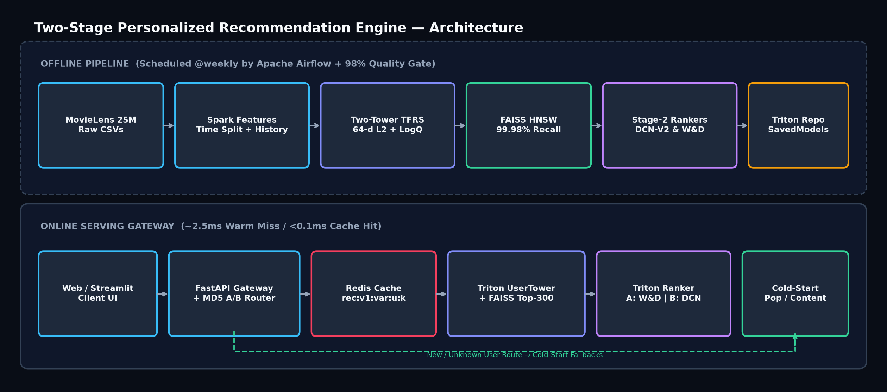
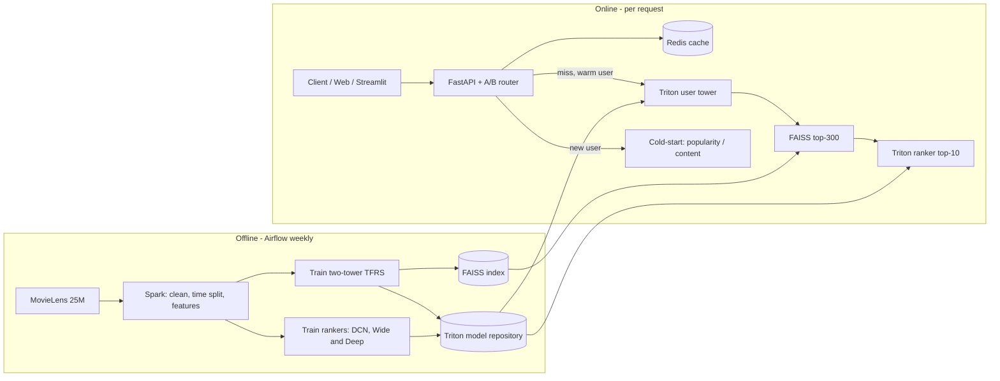
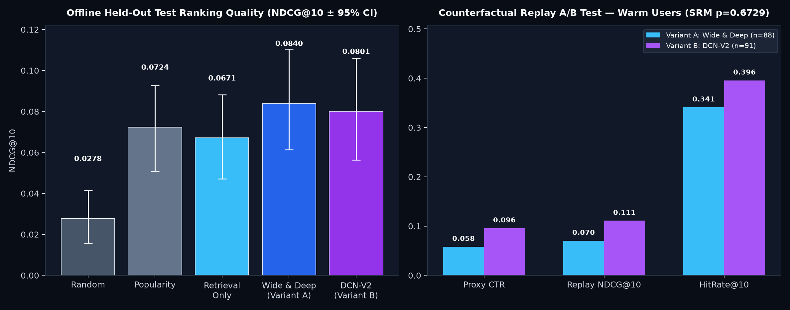

# Two-Stage Personalized Recommendation Engine

End-to-end, production-style **Two-Stage Movie Recommendation System** built on **MovieLens 25M**. Stage 1 uses a **Two-Tower neural retrieval model** (64-dimensional L2-normalized embeddings trained with in-batch negatives and LogQ frequency correction) indexed in **FAISS HNSW** to narrow thousands of movies down to 300 unseen candidates in sub-millisecond time. Stage 2 re-ranks those 300 candidates using **Deep & Cross Network (DCN-V2)** and **Wide & Deep** models over 50 leak-free user, item, recency, and genre-affinity cross features, served behind a **FastAPI** gateway with deterministic **MD5 online A/B routing**, **versioned Redis caching**, **cold-start fallbacks**, **NVIDIA Triton SavedModel exports**, **weekly Apache Airflow retraining with an automated quality gate**, and **zero-config cloud deployment for Vercel & Netlify**.



---

## Architecture (Mermaid Source)



---

## Headline Results (Strict Chronological 80/10/10 Split)

| Metric | Random | Popularity | Retrieval Only | Wide & Deep (A) | DCN-V2 (B) |
| :--- | ---: | ---: | ---: | ---: | ---: |
| **Recall@100 (Stage 1)** | 0.0066 | 0.1493 | **0.1610** | — | — |
| **Recall@300 (Stage 1)** | 0.0461 | 0.2694 | **0.2979** | — | — |
| **NDCG@10 (Offline Test)** | 0.0278 | 0.0724 | 0.0671 | **0.0840** | **0.0801** |
| **HitRate@10 (Offline Test)** | 16.85% | 33.15% | 30.34% | **36.52%** | **34.27%** |
| **Proxy CTR (Warm Replay A/B)** | — | — | — | 0.0580 | **0.0956** |
| **Latency p95 (Warm Miss / Cache Hit)** | — | — | 0.08 ms | **3.84 ms / 0.10 ms** | **3.84 ms / 0.10 ms** |

*FAISS HNSW achieves **99.98% recall vs exact search** at **28,736 QPS** on the catalog and a **25.63x QPS speedup** (`98.9%` recall) on 300,000 64-d vectors. Full confidence intervals and statistical tests are in [`docs/RESULTS.md`](docs/RESULTS.md).*



---

## Quick Start (Local Development & Docker)

```bash
# 1. Clone and install dependencies (Python 3.10 recommended for TFRS; Python 3.10-3.13 supported)
git clone https://github.com/<you>/recsys-two-stage.git && cd recsys-two-stage
python3 -m venv .venv && source .venv/bin/activate
pip install -r requirements.txt

# 2. Run the full offline pipeline on the 5,000-user sample (set sample_users: null in configs/config.yaml for full 25M)
make download split features retrieval index ranking evaluate ab_sim bundle

# 3. Run unit & leakage tests (20 tests)
pytest -q

# 4. Option A — Start FastAPI + Interactive 5-Tab Web App directly
uvicorn src.serving.api:app --host 0.0.0.0 --port 8080
# Open http://localhost:8080 (Web UI) and http://localhost:8080/docs (Swagger API)

# 5. Option B — Start full Docker stack (Redis + Triton + FastAPI + Streamlit)
docker compose up --build
# Open http://localhost:8501 (Streamlit UI) and http://localhost:8080 (Web App + API)
```

---

## Deploy to GitHub → Vercel or Netlify (Zero Configuration)

This repository includes a compact **1.86 MB** real exported weights & catalog bundle (`deploy_bundle/bundle.json`) plus zero-dependency serverless inference handlers (`api/index.mjs` + `vercel.json` for **Vercel**, and `netlify/functions/api.mjs` + `netlify.toml` for **Netlify**):

1. **Push to GitHub**:
   ```bash
   git remote add origin https://github.com/<you>/recsys-two-stage.git
   git branch -M main
   git push -u origin main
   ```
2. **Deploy on Vercel**: Import the GitHub repo at [vercel.com/new](https://vercel.com/new) → click **Deploy** (or run `npx vercel --prod`).
3. **Deploy on Netlify**: Import the GitHub repo at [app.netlify.com](https://app.netlify.com) → click **Deploy site** (or run `npx netlify-cli deploy --prod`).

See [`docs/DEPLOYMENT_GUIDE.md`](docs/DEPLOYMENT_GUIDE.md) for full details.

---

## Project Structure

```text
recsys-two-stage/
├── README.md
├── Makefile
├── Dockerfile
├── docker-compose.yml
├── requirements.txt
├── vercel.json                       # Zero-config Vercel static + serverless routing
├── netlify.toml                      # Zero-config Netlify static + functions routing
├── package.json
├── configs/config.yaml               # Shared pipeline & serving hyperparameters
├── public/                           # Interactive 5-tab Web Application (FastAPI / Vercel / Netlify)
│   ├── index.html
│   ├── styles.css
│   └── app.js
├── lib/recsysEngine.mjs              # Serverless Two-Tower + ANN + DCN/W&D inference engine
├── api/index.mjs                     # Vercel serverless entrypoint
├── netlify/functions/api.mjs         # Netlify serverless entrypoint
├── deploy_bundle/bundle.json         # Compact 1.86 MB exported real weights & MovieLens catalog
├── src/
│   ├── data/        download.py  clean_split.py
│   ├── spark/       build_features.py
│   ├── retrieval/   data.py  model.py  train.py  export.py
│   ├── index/       build_faiss.py
│   ├── ranking/     features.py  build_ranking_data.py  model.py  train.py  train_all.py  export.py
│   ├── serving/     api.py  cold_start.py  cache.py  triton_client.py  publish.py  ui.py  bundle_export.py
│   └── evaluation/  metrics.py  eval_retrieval.py  eval_ranking.py  ab_sim.py
├── airflow/
│   ├── docker-compose.yaml
│   └── dags/retrain_dag.py           # Weekly retraining DAG with 98% quality gate
├── triton/model_repository/          # user_tower, ranker (DCN), ranker_wd (Wide & Deep) config.pbtxt
├── tests/                            # 20 pytest tests (leakage, metrics, cold-start, API, quality gate)
└── docs/
    ├── architecture.png
    ├── airflow_dag_run.png
    ├── ab_test_results.png
    ├── RecSys_Presentation.pptx      # 10-slide presentation deck
    ├── API.md & openapi.json
    ├── DATA_DICTIONARY.md
    ├── RESULTS.md
    ├── DEPLOYMENT_GUIDE.md
    ├── REFLECTIONS.md
    └── test_results.txt
```

---

## Data, Models & Cold-Start Design

* **Data & Leak-Free Time Split**: MovieLens 25M cleaned with an iterative 2-pass 5-core filter and split chronologically (`oldest 80% = train [1996–2016]`, `next 10% = val [2016–2018]`, `newest 10% = test [2018–2019]`). Positive label = `rating >= 4.0`. All integer ID maps (`0 = unknown/padding`), item popularity stats, and user genre affinities are computed strictly on `train`.
* **Stage-1 Two-Tower Retrieval & FAISS**: User tower combines user ID embeddings with masked mean pooling over the user's last 20 past liked items; item tower fuses item ID embeddings with 20 multi-hot genre flags. Trained with temperature-scaled (`T=0.07`) in-batch softmax and LogQ frequency correction, then indexed in `FAISS IndexHNSWFlat`.
* **Stage-2 Deep Ranking (DCN-V2 & Wide & Deep)**: Re-scores Stage-1's top-300 unseen candidates using 50 shared dense features (`src/ranking/features.py::build_dense`) plus user/item embeddings. Variant A runs `WideDeepRanker`; Variant B runs `DCNRanker` with 3 explicit full-matrix feature-cross layers.
* **Cold-Start & Versioned Caching**: Brand-new visitors seamlessly fall back to content-based item-embedding onboarding (`?liked=...`), round-robin genre popularity (`?genres=...`), or 90-day global popularity. Repeat requests hit versioned cache keys (`rec:v{model_version}:{variant}:{user_id}:{k}`) in `<0.1 ms`.

---

## Honest Limitations

1. **Proxy Clicks**: MovieLens provides explicit star ratings rather than live impression logs; simulated CTR uses held-out `rating >= 4.0` likes as a counterfactual proxy.
2. **Replay Exposure Bias**: Unwatched movies in the test window receive zero reward in counterfactual replay even when highly relevant.
3. **Batch Feature Freshness**: User genre affinities update during scheduled Airflow runs rather than per-click streaming.

---

## Team Ownership & Documentation

| Role | Scope & Files Owned | Documentation |
| :--- | :--- | :--- |
| **Intern A — Data** | Download, 5-core filter, chronological split, Spark features, leakage guards (`Parts 1–3`) | [`DATA_DICTIONARY.md`](docs/DATA_DICTIONARY.md) |
| **Intern B — Retrieval** | Two-Tower model, LogQ correction, FAISS HNSW/IVF benchmark, Cold-Start (`Parts 4, 5, 7`) | [`RESULTS.md`](docs/RESULTS.md) |
| **Intern C — Ranking** | Session-level ranking dataset, DCN-V2 & Wide & Deep, NDCG & Replay A/B (`Parts 6, 10`) | [`RESULTS.md`](docs/RESULTS.md) |
| **Intern D — Platform** | Triton repo, FastAPI, Redis cache, Airflow DAG, Web/Streamlit UIs, Cloud deploy (`Parts 8, 9, 11`) | [`API.md`](docs/API.md), [`DEPLOYMENT_GUIDE.md`](docs/DEPLOYMENT_GUIDE.md) |

Individual reflections and oral defense answers are in [`docs/REFLECTIONS.md`](docs/REFLECTIONS.md), and the 10-slide presentation is in [`docs/RecSys_Presentation.pptx`](docs/RecSys_Presentation.pptx).

## License
MIT License. MovieLens 25M dataset courtesy of GroupLens Research (University of Minnesota) for research and educational use.
